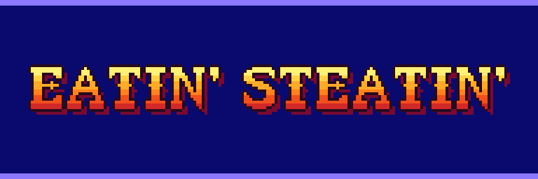
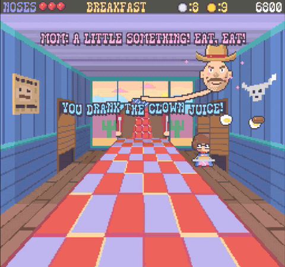
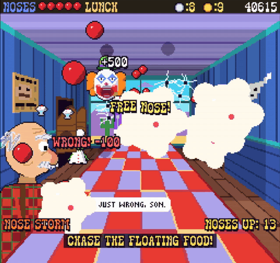
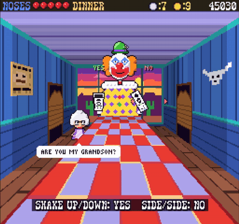
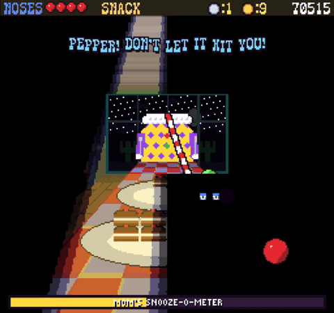

# Eatin' Steatin'

copy of the classic wii rom

*The Wii cover scan.*

## Playing in Dolphin

Copy `Eatin' Steatin'.iso`, `Eatin' Steatin'.png`, and `Eatin' Steatin'.xml` together into your Dolphin games folder. The ISO boots by itself; the PNG and XML provide artwork and game metadata.

Disc region: USA (NTSC-U). Controls: Wii Remote + Nunchuk.

## screenshots

*Breakfast: a clown transformation to start the day.*

*Lunch: a visit from the repairman at the window.*

*Dinner: saying grace, with a side of sin.*

*Midnight snack: one last bite before bed.*

## Note

This is an unsigned development build, provided as-is without any warranty.
